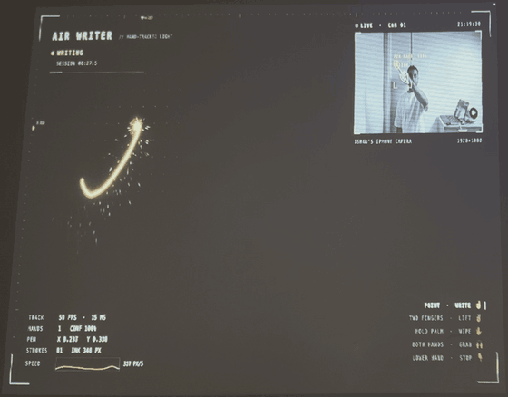
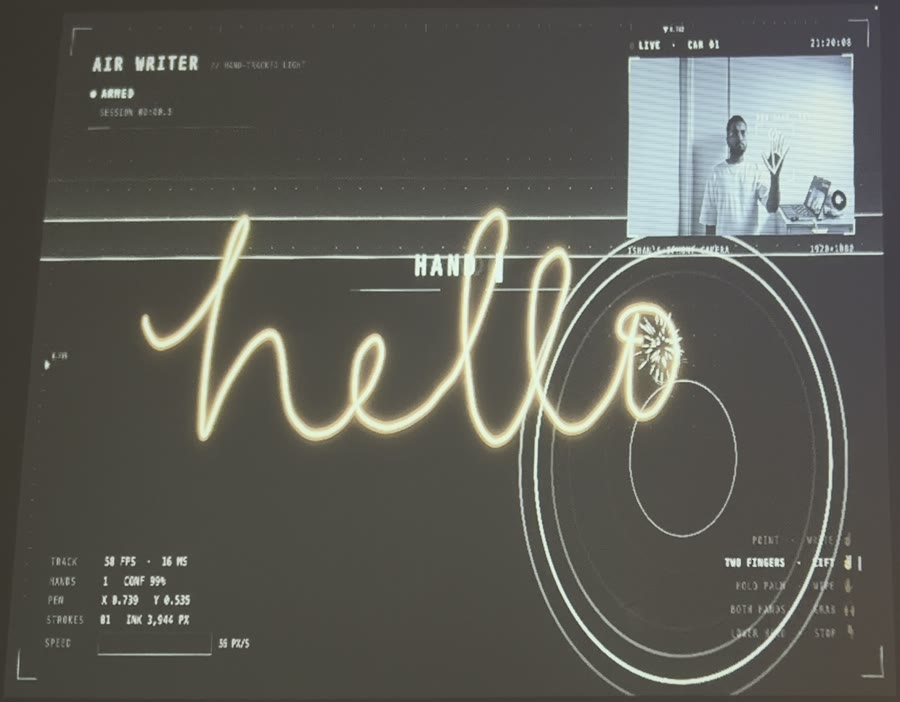
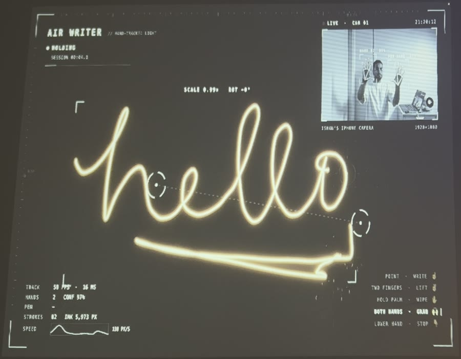

<div align="center">

# Air Writer

**Write on your wall with your finger.**

A camera tracks your hand, and a projector draws glowing sparkler ink wherever you point.<br>
It all runs in the browser, offline, with no app to install and no cloud.

[](LICENSE)




</div>

## What it does

- **Point to write.** Your index finger is the pen. Raise a second finger to lift it between letters, like lifting a real pen.
- **Show your palm to start.** Brackets lock onto your hand, a scan line sweeps the wall, and the pen ignites.
- **Grab it with both hands.** Move, rotate and resize your writing in mid-air.
- **Hold up your palm to wipe.** A bright bar sweeps the ink away.
- **A heads-up display on the wall** shows the live camera with your hand's skeleton, tracking stats and the gesture you're making. Every number on it is real.
- **Sound effects**, synthesized in the browser: a charge-up when you start, a whoosh when you wipe.

<table>
  <tr>
    <td></td>
    <td></td>
  </tr>
  <tr>
    <td align="center"><sub>Show your palm and the wall powers on</sub></td>
    <td align="center"><sub>Both hands grab the writing to move, spin and resize it</sub></td>
  </tr>
</table>

## What you need

| | |
|---|---|
| **A computer with Chrome** | Mac, Windows or Linux. Chrome handles the camera, the full-screen projector window and the glow best. |
| **A camera** | An iPhone through Continuity Camera, or any webcam Chrome can see. It faces you, so it can see your hand. |
| **A projector** | Pointed at the wall you write on. A TV or a second monitor works too. |
| **Node.js 20.19 or newer** | To run the app locally. |

## Quick start

```bash
git clone https://github.com/Ishan-sa/air-writer.git
cd air-writer
npm install
npm run dev
```

Open **http://localhost:5199** in Chrome and allow the camera. Everything, including the hand-tracking model, is served from your machine, so it keeps working with no internet.

There are two windows:

- **Control view** (your laptop screen): the camera feed, the status, calibration and settings.
- **Wall view** (the projector): the ink and the heads-up display. Press **W** to open it.

## Set it up in five steps

1. **Connect the projector** and set it to extend your desktop, not mirror it (macOS: *System Settings → Displays*).
2. **Place the camera near the wall, facing you**, at about chest height, about 1 to 1.5 m from where you'll stand. It needs a clear view of your writing hand.
3. **Open the wall window** with **W**. If Chrome asks to manage windows on all your displays, allow it and the window jumps to the projector; otherwise drag it there. Click it once (that turns sound on) and press **F** for full screen.
4. **Calibrate** with **C** (about 20 seconds). The wall shows four corner targets, one at a time. Move your hand to each corner of the area you'll write in, point, and hold for half a second. It's saved, so you only redo it when you, the camera or the projector moves.
5. **Write.** Hold an open palm up toward the camera for half a second to start, then point.

Not calibrated yet? It still works: ink is drawn big in front of you.

## Gestures

| Do this | To |
|---|---|
| Hold an open palm up for ½ s | **Start** writing |
| Point your index finger | **Write** |
| Raise your middle finger too (two fingers up) | **Lift the pen** between letters |
| Hold an open palm up for 1 s, or swipe it sideways | **Wipe** the wall |
| Raise both open hands | **Grab** the writing: slide, twist and spread to move, rotate and resize |
| Lower your hand out of view for 1 s | **Stop** |

Prefer pinching? Switch *Draw with* to **Pinch** under Tuning, or press **P**.

> **Write in one stroke where you can.** Cursive "hello" in a single movement looks the most natural on the wall.

## Making it look good on camera

**Lighting.** Turn the room lights down so the ink glows, but keep a dim light on yourself from the wall side. In the dark the camera can't see your hand, and an iPhone also slows its frame rate in low light, which makes the ink lag. The control view tells you when the light is too low or tracking slows down.

**Projector placement.** Put it high or off to one side. Directly behind you at shoulder height, your hand's shadow lands right where the ink appears. To check, press **M** on the wall to draw with the mouse, then raise your hand in your spot.

**Hiding the projector's gray rectangle.** A projector's black is really dim light. Fix it on the filming camera: lock exposure on the glowing ink (on iPhone, tap and hold until *AE/AF Lock*, then drag the sun down), turn the projector's brightness down, and crush the blacks a little in the edit.

**Clean shot.** **H** hides the heads-up display and **V** hides the camera window, if you want just the ink.

## Tuning

Under *Tuning* in the control view. Settings are remembered.

| Setting | Turn it **up** if… | Turn it **down** if… |
|---|---|---|
| **Smoothing** | lines look shaky | the ink trails your hand or letters look rounded (0 is off) |
| **Ink thickness** | words are hard to read on camera | letters blob together |
| **Sparks** | you want more sparkle | sparks distract from the words |
| **Pinch sensitivity** (pinch mode) | strokes break mid-pinch | ink appears when you didn't pinch |

## Keys

| Key | Where | What |
|---|---|---|
| W | control | open the wall window |
| C | either | calibrate (Q cancels; Space captures a corner) |
| X / Z | either | clear the wall / undo the last stroke |
| S | either | pause tracking, for when you're typing with your hands in view |
| H / V | either | hide the heads-up display / the camera window |
| P / T | control | point or pinch / dark, light or auto theme |
| F / M | wall | full screen / draw with the mouse |

Tracking also pauses by itself while you type, click or move the mouse in the control view.

## Troubleshooting

- **No camera.** Allow Chrome in *System Settings → Privacy & Security → Camera*. For an iPhone: same Apple ID as the Mac, Wi-Fi and Bluetooth on, phone nearby. Pick it from the camera menu under the video.
- **Ink lags.** Check the frames-per-second readout. Below 20, add light on yourself, and keep the control window visible: Chrome slows down covered windows.
- **Lines are shaky.** Your hand is too small in the camera's view. Move the camera closer and recalibrate.
- **Ink lands in the wrong place.** Recalibrate from the exact spot you'll stand in.
- **The picture doesn't fill the projector.** On a Mac, set the projector's *Underscan* to off in Displays. On the projector, set aspect to Auto or 16:9, digital zoom to 100% and keystone to 0.
- **No sound.** Click the wall window once. Browsers keep sound off until you do.

## How it works

```
 camera ──▶ control window ──BroadcastChannel──▶ wall window ──▶ projector
            MediaPipe hands                       ink, sparks, HUD
            gestures, calibration
```

- **Tracking**: [MediaPipe Hand Landmarker](https://ai.google.dev/edge/mediapipe/solutions/vision/hand_landmarker) finds 21 points on each hand in every frame, on the GPU, in the browser.
- **Gestures** use the 3D hand points: how far each finger reaches from the wrist tells pointing from two fingers up, and an open palm only counts when it's held upright, so hands on a keyboard don't start a session.
- **Calibration** fits a least-squares mapping from where your hand is in the camera image to where it points on the wall.
- **Smoothing** is a [One Euro filter](https://gery.casiez.net/1euro/) on the hand, then a "lazy brush" string stabilizer and a light Gaussian pass on the stroke, the same tricks drawing apps use.
- **Rendering** bakes finished strokes into an offscreen layer once, so only the live stroke is redrawn each frame.

## Development

```bash
npm test        # unit tests: gestures, calibration, start/stop flow, grab, smoothing
npm run build   # type-check and production build into dist/
npm run dev:lan # serve over HTTPS on your network, to run it from another computer
```

| Folder | What's in it |
|---|---|
| `src/tracking/` | MediaPipe setup, gestures, the start/stop session, two-hand grab, calibration, smoothing |
| `src/control/` | the control view: camera, tracking loop, status and settings |
| `src/wall/` | the wall view: ink, sparks, heads-up display, sound effects |

In dev mode the control and wall windows log tracking data to `logs/diag.jsonl`. Every tuning number in the code came from those logs. The original design notes are in [docs/specs](docs/specs/2026-10-17-air-writer-design.md).

## Credits

The hand model in `public/models/hand_landmarker.task` is Google's [MediaPipe Hand Landmarker](https://ai.google.dev/edge/mediapipe/solutions/vision/hand_landmarker), used under the Apache License 2.0.

## License

[MIT](LICENSE) © Ishan Sachdeva

<div align="center">
<sub>Built by <a href="https://ishansa.dev">Ishan Sachdeva</a> · <a href="https://instagram.com/ishaninit">@ishaninit</a></sub>
</div>
